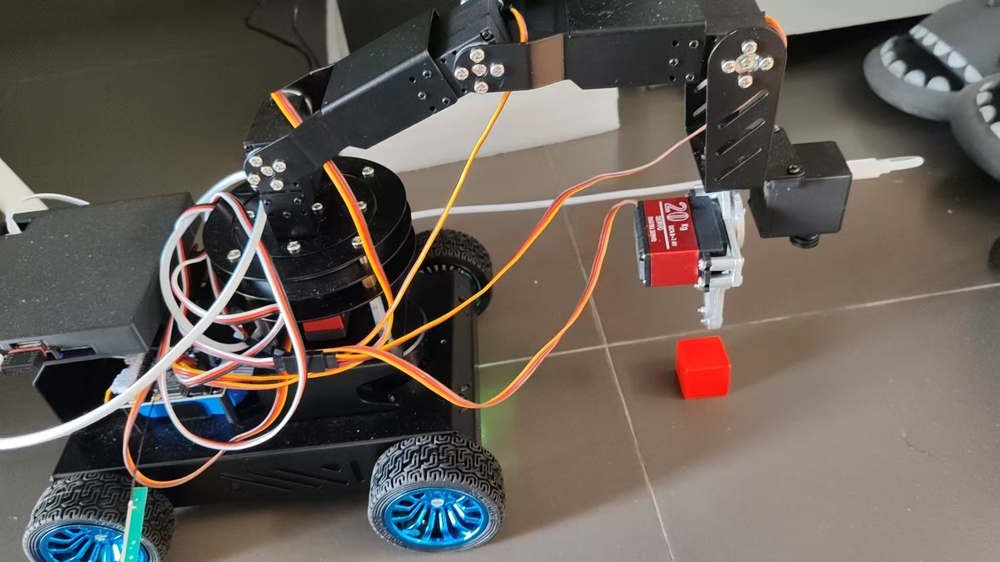
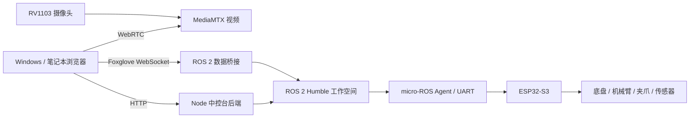

# ROS 2 机械臂小车与五色视觉跟随

基于 **Leap ROS Pro** 的机械臂小车二次开发项目，整合 S905L3A 主控上的 ROS 2 驱动、建图导航、浏览器机器人中控台，以及 ESP32-S3 固件参考源码。

项目已实现五色方块识别、红框标注、机械臂视觉跟随、单舵机限位与发送角度记忆，正在为同一批 **25 mm 纯色方块的智能抓取与放置**准备标定和执行流程。

> **当前阶段：颜色识别与跟随可用，自动抓取尚未实现。** 用户已实测原小车 Demo 和颜色识别；软件回归测试使用模拟视频/控制连接，不能替代实物抓取验证。



## 功能介绍

| 模块 | 功能 |
| --- | --- |
| 浏览器中控台 | Windows/笔记本通过网页访问小车，显示连接、地图、相机、里程计及控制工具 |
| 底盘控制 | 摇杆与键盘控制前后、横移和旋转，线速度/角速度可配置；实际运动能力取决于底盘轮组和模型选择 |
| 相机视频 | 自动发现 MediaMTX WebRTC 通道，支持 HTTP/MJPEG 地址；使用原生 video 读取画面并叠加识别结果 |
| 五色识别 | 识别红、蓝、绿、黄、橙色紧凑目标，红框显示所选目标 |
| 机械臂跟随 | 使用通道 1 左右、通道 4 上下，以图像偏差驱动目标靠近画面中心 |
| 单舵机控制 | 1–5 通道可视化角度范围、输入和发布入口校验、按通道记忆本页上次发送角度 |
| 末端坐标控制 | 输入 X/Y/Z 与俯仰角，经 ROS 2 服务提交末端目标 |
| 建图管理 | 网页启动/停止 GMapping，保存地图、查询已有地图；另保留 Cartographer 相关配置 |
| 轻量导航 | 激光匹配定位、A* 规划与路径跟踪，支持差速/全向配置、地图选择、目标及多点操作、取消导航 |
| 传感器与模型 | MCU 里程计/IMU、EKF 输入适配与融合、雷达接口、底盘 URDF 和 TF |
| 通信与部署 | micro-ROS UART Agent、启动握手/心跳、主控 WiFi 服务覆盖配置、网页 TF/里程计节流 |

ROS 软件支持哪些模式不等同于实物具备哪些运动自由度。例如普通四轮差速轮组不能仅靠选项变成麦克纳姆轮组。请按实际轮组与固件配置使用。

## 功能亮点

### 1. 适合轻量主控的颜色识别

HSV 颜色分割与连通轮廓筛选在 **浏览器**处理，采样最多 **320×240、8 FPS**；S905L3A 沿用视频与 ROS 转发，不增加模型推理服务。通过目标面积、紧凑程度、宽高比和位置连续性过滤干扰，避免立即跳到远处同色物体。

纯色识别不测量真实物体尺寸，光照、遮挡及同色背景仍需实机验证。

### 2. 目标暂时消失后持续等待

- 没检测到目标时保持识别和已开启的跟随意图，暂停发令，不盲目扫描。
- 目标重现后重新确认位置，等待上一轨迹稳定后自动继续。
- 手动停止后不会因目标重现而重新启动。
- 视频丢失、停滞超过 600 ms 或像素不可读时关闭识别与跟随，视频恢复需手动开启。

### 3. 固定实物方向与平滑跟随

用户确认：通道 1 数值增大向左，通道 4 数值增大向下。

| 目标位置 | 关节目标变化 |
| --- | --- |
| 偏右 | 通道 1 −10° |
| 偏左 | 通道 1 +10° |
| 偏下 | 通道 4 +10° |
| 偏上 | 通道 4 −10° |

同关节、同向大偏差最早 **0.8 秒**更新，换轴/换向/近中心至少等待 **1.2 秒**，配合原固件约 1 秒全局插值。目标采用 160 ms 低通滤波，相近轴误差优先保持当前关节，跨中心保留较近位置抑制摆动。一次只发一个关节，限位处截断，跟随不驱动夹爪。

### 4. 角度范围可视化与逐通道记忆

输入框、滑块及绿色允许范围按通道变化；非法值在组件和实际发布入口拦截。切换通道恢复该通道最近一次成功发送的目标，未发送的编辑和失败发送不覆盖记录。一键回正先校验整个序列。

角度记录仅在本页有效，刷新后重置；记录代表目标指令，不代表真实关节遥测。页面内对跟随、手动机械臂及导航建立互斥，其他 ROS 发布者仍需独立约束。

### 5. 保留完整开发链路与来源

仓库收录主控当前源码快照和本地适配的 MCU 参考源码，包含构建入口、接口定义、服务配置、回归测试及审查记录。`SOURCE_SNAPSHOT.json` 与 `FIRMWARE_SOURCE.json` 记录来源和文件校验值，方便不同电脑核对版本。

## 关键夹爪约束：164° 尚未统一部署

用户实测这批方块：**120° 完全张开，持块闭合不超过 164°**。继续加大会机械受阻，可能导致整车保护断电/重启。

当前源码快照仍存在：

| 通道 | 当前网页范围 | 说明 |
| --- | --- | --- |
| 1 | 20–180° | 已按实物限制 |
| 2 | 0–170° | 已按实物限制 |
| 3 | 0–180° | 已按实物限制 |
| 4 | 40–180° | 已按实物限制 |
| 5 | **120–180°** | 新的持块上限 164° 还未统一实现 |

旧回正夹爪值和作者固件源码启动值为 **180°**。持块时不要执行旧回正或大于 164° 的目标。自动抓取前需统一手动、回正、启动、控制器、抓取和恢复路径。没有电流/真实关节遥测，不能靠继续增加角度确认夹紧。

这是实际源码状态与已知待办，不应把现有网页限位当作整个机器人所有控制路径的保护。

## 系统结构



## 仓库结构

```text
ros2_web/                       # 主控网页、后端、颜色识别/跟随与测试
chuyun_ws/src/                  # 从主控导出的 ROS 2 包
  leap_interfaces/              # 机械臂与 PID 服务定义
  xuegecar_bringup/             # 机器人描述、IMU/里程计适配与 EKF
  xuegecar_description/         # 当前底盘 URDF
  xuegecar_navigation2/         # 轻量定位、A* 与跟踪
  xuegecar_camera/              # HTTP 视频转 ROS 图像工具
  xuegecar_wifi_config/         # 网络配置与 host_info
  slam_gmapping/               # GMapping ROS 2 启动与节点
  openslam_gmapping/           # 上游 SLAM 库
  xuegecar_cartographer/       # Cartographer 配置
  micro-ROS-Agent/             # micro-ROS Agent ROS 包
  micro_ros_msgs/              # micro-ROS 消息
leap_ros_four_mcu_driver/        # 本地 ESP32-S3 固件参考工作树快照
device_config/                 # systemd、UART 启动器与 WiFi 覆盖配置
docs/images/                   # 用户提供的实物/相机照片
SOURCE_SNAPSHOT.json            # 主控快照来源与 SHA256
FIRMWARE_SOURCE.json            # MCU 上游提交与本地修改记录
THIRD_PARTY.md                 # 来源和组件许可说明
```

构建输出、依赖目录、录包、历史压缩包、固件二进制和用户采集地图不纳入源码。导航需自行生成或导入地图，并在界面/启动参数中选择真实地图；仓库不包含默认 `room.yaml` 对应的现场地图。

## 在已有小车上启动

已使用的设备环境：Ubuntu 22.04/Armbian、ARM64、ROS 2 Humble、Node.js 20、MediaMTX、micro-ROS Agent。笔记本/Windows 用浏览器和 SSH 即可。

本仓库保留原部署路径约定：网页 `/root/ros2_web`，ROS 工作空间 `/root/chuyun_ws`。从其他路径开发时，需同步修改 `ros_config.json`、脚本和服务中的绝对路径；部署前比较并备份当前运行文件。

在主控终端：

```bash
cd /root/ros2_web
./start_console.sh
```

浏览器打开 `http://<主控实际IP>:5173`。后端默认 3000，Foxglove 8765，WebRTC 8889；具体视频路径由发现接口和现场配置决定。DHCP 地址会变化，不按网址显示顺序机械选择某一条。

网页配置入口为 `ros2_web/ros_config.json`，包括启动任务、话题、服务、地图目录和相机地址。实际摄像头与网络参数需要按现场设置，示例私网地址不能套用到所有设备。

## 本地网页开发与测试

Node.js 18+；在独立项目目录安装本平台依赖：

```bash
cd ros2_web
npm ci
npm test
npm run build
```

Windows 可以运行同样的 npm 测试与构建。不要把 Windows 的 `node_modules` 复制到 ARM64 主控。启动整套机器人中控台后端需要 Linux 与原 ROS 环境；本地 Vite 开发不代表已经连上机器人。

当前测试覆盖五色检测、误检筛选、10°方向、限位、低通滤波、连续发令/换轴等待、插值模型、目标丢失/重现、手动停止及关节发送记忆。已有本地与主控 **25 项测试通过**的记录；真实视频读取和用户实际颜色识别均有验证。构建与模拟通过不等同实物抓取成功。

## ROS 2 源码开发

已有主控上先确认当前 `/root/chuyun_ws/src` 和此快照的差异，再合并代码。通用工作空间构建方式：

```bash
source /opt/ros/humble/setup.bash
cd /root/chuyun_ws
rosdep install --from-paths src --ignore-src -r -y
colcon build --symlink-install
source install/setup.bash
```

Agent 和部分上游包可能需要联网下载/构建依赖。新系统还需要按各包清单安装 Foxglove、地图服务器、TF、定位和原硬件驱动；此仓库是源码快照，不是完整系统镜像。不要为了运行网页就无差别重编译或覆盖正常设备。

MediaMTX 二进制不包含在仓库；服务与示例配置位于 `device_config/`，按现场版本、相机地址和安装位置配置。

## MCU 固件

参考源码来自 [leap_ros_pro_mcu_driver](https://github.com/czu963889306-dev/leap_ros_pro_mcu_driver)，本地基准为 `d2690b35fc0dff95fa65f48dd2820bc2d29cc4c8`，包含本地适配；实际烧录二进制与此工作树是否一致仍需核对。

参考工程目标 ESP32-S3，锁文件记录 ESP-IDF 5.5.3。**按用户开发约束，Windows 不编译 ESP 固件**；配置阶段也可能触发 micro-ROS 构建。Linux 构建准备见 [LINUX_BUILD_HANDOFF.md](leap_ros_four_mcu_driver/doc/LINUX_BUILD_HANDOFF.md)。仓库不含可直接烧录的固件产物。

## 自动抓取的下一阶段

- [x] 原小车网页控制、视频、颜色识别与跟随代码整理。
- [x] 分通道输入范围、发送校验和目标角度记忆。
- [x] 10°平滑跟随、目标重现继续、视频丢失停识别。
- [ ] 164°夹持限制统一到回正/启动/控制器/自动流程。
- [ ] 验证坐标原点、轴向、TCP、落点与重复性。
- [ ] 固定观察姿态的平面/示教映射，或经验证的完整手眼标定。
- [ ] 预抓取、下降、夹持、抬升验证、转运放置、中止与恢复状态机。

用户实测一个参考点：`X=0,Y=0.18,Z=0.12,pitch=0°`；X 正向右、Y 正向前、Z 减小接近地面，当前位置抓取高度参考 `Z=0.05`。这不证明整片工作区都适用，也不能把 Z=0 当作地面。

原 `/set_arm_pose` 成功只表示入队，源码 IK 可能调整俯仰；现有 URDF 没有完整机械臂/相机链，`/arm_pose` 是模型估计。第一版可评估固定观察＋平面/示教或图像视觉伺服，不能直接把像素当成 XYZ。

## 进一步阅读

- [颜色识别与跟随](COLOR_FOLLOWING.md)
- [网页舵机限制与验证](WEB_ARM_LIMITS.md)
- [抓取系统审查与准备](GRASP_SYSTEM_REVIEW.md)
- [主控检查与 WiFi 调整](DEVICE_INSPECTION.md)
- [ESP 固件源码交付背景](ESP_FIRMWARE_REVIEW.md)
- [来源与许可](THIRD_PARTY.md)
