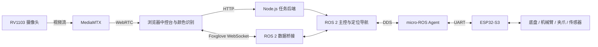

# ROS 2 机械臂移动机器人视觉控制系统

基于 **Leap ROS Pro** 的机器人二次开发项目，将底盘控制、机械臂操作、实时视频、五色目标跟随和激光建图导航整合到一个浏览器中控台。

项目采用 **浏览器视觉处理 + ROS 2 主控 + ESP32-S3 执行控制**的分层架构。PC 或笔记本通过网页完成机器人操作与状态查看，S905L3A 负责 ROS 2 通信、定位与导航，ESP32-S3 负责底盘、机械臂和传感器接口。

**技术栈：** ROS 2 Humble · C++ · Python · Vue 3 · JavaScript · Node.js · micro-ROS · MediaMTX · ESP-IDF


## 项目功能

| 模块 | 已实现能力 |
| --- | --- |
| 网页中控台 | 集中展示地图、视频、连接状态、里程计及机器人控制工具 |
| 底盘遥控 | 摇杆与键盘控制，支持线速度、角速度设置，按底盘类型生成运动指令 |
| 机械臂控制 | 1–5 通道角度控制、滑块调节、可视化范围、一键回正、末端 XYZ 与俯仰角目标输入 |
| 五色目标识别 | 红、蓝、绿、黄、橙色方块检测，所选目标红框标注与位置跟踪 |
| 机械臂视觉跟随 | 根据图像偏差驱动左右与俯仰关节，使目标靠近画面中心 |
| 实时视频 | 自动发现 WebRTC 通道，支持 HTTP/MJPEG 视频源、手动切换与重新连接 |
| 激光建图 | 网页启动/停止 GMapping，地图显示、保存和查询 |
| 定位导航 | 激光匹配定位、A* 路径规划、路径跟踪、地图选择、多点目标与导航取消 |
| 状态监测 | 里程计、IMU、EKF 融合、TF 和地图图层展示 |
| 通信与部署 | Foxglove WebSocket、micro-ROS UART、主控心跳、systemd 服务与网页数据节流 |

## 核心亮点

### 轻量化视觉处理，适配嵌入式主控

颜色识别在浏览器端完成，以最多 **320×240、8 FPS** 的采样进行 HSV 颜色分割和连通轮廓分析。通过面积、宽高比、紧凑程度和目标位置连续性筛选方块，识别与显示共用同一路视频。

这套处理将视觉计算分配到 PC/笔记本，S905L3A 继续承担 ROS 2、定位导航与视频转发，适合小型机器人平台。

### 图像反馈驱动的平滑跟随

- 使用已实测的通道方向：通道 1 控制左右，通道 4 控制上下。
- 常规目标步长 **10°**，到达限位时截断到边界。
- 同向大偏差时最早 **0.8 秒**更新目标，换轴、换向和近中心时等待至少 **1.2 秒**。
- 使用 **160 ms 位置低通滤波**抑制画面抖动，两个轴偏差接近时保持当前轴，减少频繁切换。
- 跨过中心后保留较近位置，减少固定步长引起的往返摆动。

### 连续识别与目标重现恢复

目标暂时离开画面时，系统保持识别和已开启的跟随意图，暂停发令；目标重新出现后确认新位置并自动继续。等待期间不发送盲目搜索动作。

视频丢失、停滞或像素不可读取时关闭识别与跟随；手动停止不会因目标重现而自动启动。页面内对自动跟随、手动机械臂和导航操作进行互斥管理。

### 分通道限位与角度记忆

切换舵机通道时，数字输入、滑块和允许角度范围同步更新。无效值在组件层与实际发布入口校验；每个通道独立保存本页最近一次成功发送的目标角度，未发送的修改和发送失败不覆盖记录。

范围可视化使调姿更直观，逐通道记忆减少了切换操作时重复设置角度的工作量。

### 建图、导航与交互控制整合

将 GMapping、激光匹配定位、A* 规划和路径跟踪接入网页任务管理，支持地图选择、导航目标、多点操作及取消导航。地图、激光、轨迹和机器人状态通过统一界面查看，降低现场操作成本。

### 面向实际工程的通信与验证

网页通过 Foxglove 与 ROS 2 交互，ROS 2 经 micro-ROS UART 连接底层执行器。采用网页 TF/里程计节流、低带宽话题配置和心跳监控，减少板端数据处理负担。

提供 **25 项自动化测试**，覆盖颜色检测、跟随方向、限位、滤波、执行节奏、目标丢失/重现和角度记忆；网页测试与构建已在本地和主控环境通过。

## 系统架构



| 层级 | 主要职责 |
| --- | --- |
| 浏览器 | 人机交互、目标识别、红框叠加、图像反馈控制 |
| Node.js 后端 | ROS 任务启停、地图与相机管理、末端位姿服务调用 |
| S905L3A / ROS 2 | 传感器数据、EKF、TF、建图定位、路径规划与跟踪 |
| ESP32-S3 | 底盘与舵机执行、传感器接口、micro-ROS 通信 |

## 快速使用

设备环境为 Ubuntu 22.04 / Armbian、ROS 2 Humble、Node.js、MediaMTX 和 micro-ROS Agent。使用 PC/笔记本浏览器连接与小车相同的网络。

在已部署的小车主控上启动：

```bash
cd /root/ros2_web
./start_console.sh
```

访问 `http://<主控实际IP>:5173`。页面默认后端端口为 3000，Foxglove 为 8765，WebRTC 为 8889。网络地址、相机与地图设置以现场配置为准。

使用颜色跟随时，先手动向通道 1、4 发送合适的观察角度，再在摄像头卡片中选择颜色并点击“开始跟随”。刷新网页后需重新建立本页的角度记录。

网页运行配置位于 [`ros_config.json`](ros2_web/ros_config.json)，集中管理话题、服务、启动任务、地图目录与相机地址。导航前生成或导入现场地图，并选择对应地图路径。

> 实物使用约束：夹持本项目的 25 mm 方块时，夹爪张开使用 120°，闭合目标不超过 164°；持块时不要执行夹爪目标为 180° 的回正动作。角度记忆是已发送目标，坐标服务的 success 表示目标接收；实际动作需结合现场状态确认。详见[舵机控制说明](WEB_ARM_LIMITS.md)。

## 本地开发与测试

网页使用 Node.js 18+，安装本平台依赖后执行：

```bash
cd ros2_web
npm ci
npm test
npm run build
```

Windows 可进行网页开发、测试和构建；完整机器人任务在 Linux/ROS 环境运行。主控部署沿用 `/root/ros2_web` 和 `/root/chuyun_ws` 路径，迁移目录时同步调整配置及服务路径。

ROS 2 工作空间的构建入口：

```bash
source /opt/ros/humble/setup.bash
cd /root/chuyun_ws
rosdep install --from-paths src --ignore-src -r -y
colcon build --symlink-install
source install/setup.bash
```

ESP32-S3 工程的 Linux 环境配置见[固件构建说明](leap_ros_four_mcu_driver/doc/LINUX_BUILD_HANDOFF.md)。各软件层的依赖和构建产物独立管理。

## 代码结构

```text
ros2_web/                    # Vue 中控台、Node 后端、颜色识别/跟随及测试
chuyun_ws/src/               # ROS 2 接口、驱动、建图、定位与导航
leap_ros_four_mcu_driver/     # ESP32-S3 固件参考源码与本地适配
device_config/               # systemd、UART、WiFi 与视频服务配置
docs/images/                 # 实物与相机图片
SOURCE_SNAPSHOT.json         # 主控源码来源与校验值
FIRMWARE_SOURCE.json         # 固件上游提交及适配记录
THIRD_PARTY.md               # 上游来源和组件许可说明
```

## 开发工作与项目资料

本项目基于 Leap ROS Pro 原有平台进行二次开发。重点工作包括浏览器端五色识别、机械臂图像跟随、滤波与发令时序优化、目标重现处理、舵机范围可视化、逐通道角度记忆，以及这些功能与原中控台和 ROS 2 接口的集成。

原底盘、传感器、建图导航和固件组件保留其上游来源及许可说明：

- [颜色识别与跟随说明](COLOR_FOLLOWING.md)
- [舵机控制与验证记录](WEB_ARM_LIMITS.md)
- [主控服务配置](device_config/README.md)
- [来源与许可](THIRD_PARTY.md)
